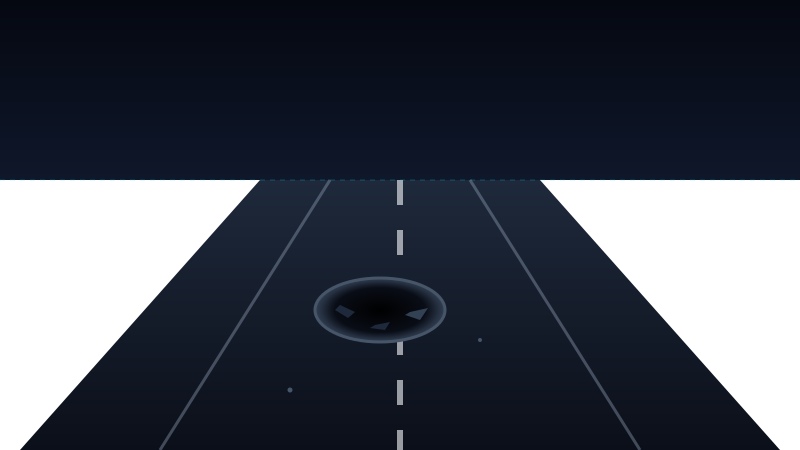

# CYCLOPS — AI Road Hazard & Environmental Intelligence Platform

> **See the Road. Understand the Risk. Protect the Future.**  
> *Detect. Understand. Predict. Sustain.*



---

## 1. Overview

**CYCLOPS** is a modern, lightweight, AI-powered road hazard detection and environmental intelligence platform designed for vehicles, commercial fleets, and smart city infrastructure. 

It transforms forward-facing vehicle cameras and dashcams into proactive safety systems executing the continuous autonomous intelligence loop:

$$\textbf{Detect} \longrightarrow \textbf{Classify} \longrightarrow \textbf{Assess} \longrightarrow \textbf{Advise} \longrightarrow \textbf{Alert} \longrightarrow \textbf{Record} \longrightarrow \textbf{Analyze}$$

### Primary Hazard Classes Supported
1. **Potholes:** Deep pavement cavities posing rim buckling and suspension shock risks.
2. **Debris:** Shed cargo, metal scraps, and obstacles causing tire punctures or swerving hazards.
3. **Fallen Trees:** Catastrophic lane obstructions requiring emergency full vehicle halt (`STOP / DO NOT PROCEED`).
4. **Waterlogging:** Surface stormwater accumulation above tire dispersion thresholds inducing hydroplaning risks.

---

## 2. Hardware-Optimized Architecture (8 GB RAM Laptop Profile)

CYCLOPS was engineered specifically to run smoothly on an **8 GB RAM laptop** without straining memory or GPU compute:

* **Zero Heavy 3D / WebGL:** All visual HUD displays, perspective road views, and cinematic visor power-on sequences use GPU-accelerated CSS transforms and lightweight SVGs.
* **Modular Detection Engine Abstraction:** Decoupled `DetectionEngine` with a fast, realistic `MockDetectionEngine` for in-memory prototype execution and an architectural stub `YOLODetectionEngine` for future production weights.
* **Dual-Mode Offline Resilience:** If the FastAPI backend is stopped or unavailable, the React frontend seamlessly falls back to an in-browser reactive simulation store without crashing.
* **Transparent Simulation Labels:** All prototype models, estimated emissions impacts, and demo benchmarks are clearly labeled with `DEMO MODE`, `AI ENGINE SIMULATION`, and `Estimated / Model-Based`.

---

## 3. Technology Stack

### Frontend
* **Core:** React 18, TypeScript, Vite
* **Styling:** Tailwind CSS (cybernetic dark mode, electric cyan and crimson glows)
* **Icons:** Lucide React
* **Charts:** Recharts (responsive bar, pie, and temporal frequency visualizations)
* **Routing:** React Router v7

### Backend
* **Framework:** Python 3.14 + FastAPI
* **Server:** Uvicorn ASGI
* **Database:** SQLite3 (lightweight, zero daemon overhead, pre-seeded with Chennai demo routes)
* **Validation:** Pydantic v2 schemas

---

## 4. Platform Pages & Routing

### Public Routes
* `/` — **Landing Page:** Cinematic hero, live intelligence cards, workflow overview, vehicle ecosystem, environmental preview, and CTAs.
* `/how-it-works` — **Pipeline Deep Dive:** Interactive 8-step pipeline visualizer (*Capture → Preprocess → Detect → Classify → Assess → Advise → Alert → Record*).
* `/technology` — **Architecture & Risk Math:** Comprehensive breakdown of the multi-variable risk scoring model, speed advisory equations, and edge compute topologies.
* `/model-lab` — **AI Model Comparison:** Benchmark evaluation matrix comparing YOLOv8 Edge, LightRoad-Tiny, and Vision Transformer models.

### Command Center & Lab Routes
* `/dashboard` — **Command Center:** Real-time KPI cards, live road camera optical HUD, active advisory gauge, instant alert feed, and quick demo triggers.
* `/detection` — **Detection Lab:** Interactive workspace with scenario presets (Pothole, Debris, Tree, Waterlogging, Clear), custom image upload, driving speed sliders, host vehicle selector, and pipeline progress visualization.
* `/history` — **Incident Archive:** Searchable and filterable detection database with CSV export and detail dossier inspector.
* `/map` — **Hazard Intelligence Map:** Interactive vector map covering the Chennai Demo Zone (Anna Nagar, Marina Beach Road, OMR IT Corridor, Airport GST Road, Guindy) with animated hazard pins and popups.
* `/analytics` — **Risk Analytics:** Recharts visualizations for classification distribution, temporal frequency, risk severity tiers, and fleet encounter rates.
* `/environment` — **Environmental Intelligence:** Road disruption index, congestion delay, estimated fuel wastage, and flood risk metrics (*strictly labeled Estimated / Model-Based*).
* `/vehicles` — **Vehicle Intelligence:** Multi-fleet dynamics matrix for Passenger Cars, Emergency Vehicles, Commercial Trucks, Transit Buses, and Service Sweepers.
* `/settings` — **System Settings:** Demo mode toggles, replay cinematic intro, motion settings, and API base URL configuration.

---

## 5. Getting Started & Installation

### Prerequisites
* Node.js v18+ (verified on Node v24)
* Python 3.10+ (verified on Python 3.14)

### 1. Backend Setup
```bash
cd backend
py -m pip install -r requirements.txt
py -m uvicorn app.main:app --port 8000 --host 0.0.0.0
```
The FastAPI backend will automatically initialize and seed `cyclops.db` with Chennai demo corridor telemetry.
* API Documentation: `http://127.0.0.1:8000/docs`
* Health Check: `http://127.0.0.1:8000/api/health`

### 2. Frontend Setup
```bash
cd frontend
npm install
npm run dev:public
```
The Vite development server will launch at `http://localhost:5173/`. To use it from a phone on the same Wi-Fi, open `http://YOUR-COMPUTER-LAN-IP:5173/` (find the address with `ipconfig`). Both services bind to all network interfaces; Windows Firewall must allow Node and Python on the private network.

### 3. Production Build
```bash
cd frontend
npm run build
```
Creates an optimized production bundle in `frontend/dist/`.

---

## 6. REST API Endpoints

| Method | Endpoint | Description |
| :--- | :--- | :--- |
| `GET` | `/api/health` | Service health, version, and hardware profile |
| `POST` | `/api/detect` | Execute road hazard inference and generate speed advisory |
| `GET` | `/api/detections` | Retrieve archived detection incidents (supports `?limit` and `?hazard_type`) |
| `GET` | `/api/detections/{id}` | Inspect a single detection dossier by unique ID |
| `GET` | `/api/statistics` | Aggregate KPI statistics for command dashboard |
| `GET` | `/api/alerts` | Active high-risk road alerts |
| `GET` | `/api/road-health` | Prototype Road Health Index scores across monitored segments |
| `GET` | `/api/environment` | Modeled congestion delay, fuel overhead, and emissions estimates |
| `GET` | `/api/vehicles` | Multi-fleet dynamics profiles and braking multipliers |
| `POST` | `/api/advisory` | Standalone rule-based speed advisory computation |
| `GET` | `/api/models` | Benchmark metrics for candidate edge models |

---

## 7. Project Structure

```
CYCLOPS/
├── backend/
│   ├── app/
│   │   ├── api/
│   │   │   └── endpoints.py         # FastAPI REST endpoints
│   │   ├── database/
│   │   │   ├── connection.py        # SQLite schema and connections
│   │   │   └── seed.py              # Realistic Chennai demo route seeder
│   │   ├── engines/
│   │   │   ├── detection.py         # DetectionEngine base & MockDetectionEngine
│   │   │   └── advisory.py          # RuleBasedAdvisoryEngine with vehicle dynamics
│   │   ├── models/
│   │   │   └── schemas.py           # Pydantic schemas (Detection, Advisory, Alert, etc.)
│   │   └── main.py                  # FastAPI entry point & CORS
│   └── requirements.txt
│
├── frontend/
│   ├── public/
│   │   └── samples/                 # High-contrast road hazard SVGs
│   ├── src/
│   │   ├── components/
│   │   │   ├── advisory/            # SpeedAdvisoryGauge, RiskBadge
│   │   │   ├── common/              # Navbar, Sidebar, StatusIndicator, DemoModeBadge
│   │   │   ├── intro/               # CinematicIntro (Visor, Reflection, Laser, Logo)
│   │   │   ├── landing/             # RoadVisualization, Hero widgets
│   │   │   └── map/                 # InteractiveVectorMap (Chennai Demo Zone)
│   │   ├── pages/                   # All 12 application and public pages
│   │   ├── services/
│   │   │   ├── apiClient.ts         # Dual-mode API client with automatic fallback
│   │   │   └── mockStore.ts         # In-browser reactive simulation store
│   │   ├── types/                   # TypeScript interfaces
│   │   ├── App.tsx                  # Master router and layout manager
│   │   ├── index.css                # Tailwind directives, HUD glow, and scanlines
│   │   └── main.tsx
│   ├── package.json
│   ├── tailwind.config.js
│   ├── tsconfig.json
│   └── vite.config.ts
├── .env.example
└── README.md
```

---

## 8. Original Branding & Cinematic Sequence

CYCLOPS features an **original futuristic optical vision sensor identity**. It intentionally contains **zero Marvel/X-Men copyrighted logos, artwork, or character likenesses**.

The opening sequence at `/` presents:
1. **Full Black:** Anticipation and subtle atmospheric HUD gridlines.
2. **Metallic Visor Reveal:** Aerospace/automotive sensor geometry with a central optical slit.
3. **Reflection Sweep:** Specular glint traveling across the metallic visor face.
4. **Eye Sensor Activation:** Central optical pupil awakens with concentrated crimson energy and reticle lock.
5. **Short Red Laser Flash:** Controlled horizontal energy pulse and light bloom.
6. **Logo & Tagline Reveal:** Clean presentation of CYCLOPS branding.
7. **Transition:** Smooth fade directly into the landing page.

Includes:
* Accessible **Skip Sequence** button.
* `prefers-reduced-motion` compliance.
* `cyclopsIntroSeen` localStorage caching.
* Replayable anytime from the Settings page.

---

## 9. Limitations & Future Extensions

* **Prototype Disclaimer:** Current hazard detections, risk scores, and speed advisories are produced by rule-based heuristic engines for prototype demonstration and do not replace legal traffic rules or professional driver judgment.
* **Future Work:**
  * Drop in pre-trained YOLOv8/YOLOv11 road hazard weights into `YOLODetectionEngine`.
  * Integration with live OBD-II vehicle telemetry (CAN bus speed, brake pressure).
  * WebRTC live streaming from smartphone cameras mounted on vehicle dashboards.
  * Integration with municipal road repair GIS dispatch systems.
